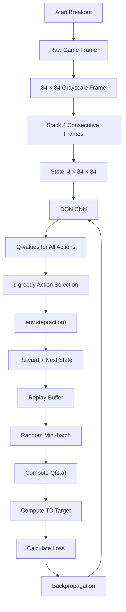

# Atari DQN — Playing Atari with Deep Reinforcement Learning

This repository contains a small-scale implementation of the Deep Q-Network (DQN) approach described in:

**Mnih et al. (2013), _Playing Atari with Deep Reinforcement Learning_**  
https://arxiv.org/abs/1312.5602

The project was developed for the **Deep Reinforcement Learning assignment** and demonstrates how an agent can learn to play Atari Breakout from screen images using trial and error.

## Goal

The aim is to teach an AI agent to play Breakout **without explicitly programming the game strategy**.

The agent:

- observes the game screen;
- chooses an action;
- receives a reward;
- stores that experience;
- learns which actions are more useful in similar situations.

In simple terms, the agent learns from experience rather than being told the correct move.

For more detailed paper notes, equations, limitations and paper-to-code mapping, see [`paper.md`](paper.md).

---

# Contributors

| Contributor | BITS ID | Main contribution |
|---|---|---|
| Ejaz Ahmed | 2025AG05320 | DQN architecture and paper analysis |
| Arshad Husain Siddiqui | 2025AG05458 | Replay buffer and training loop |
| Sahil Faraz Ansari | 2025AG05719 | Atari preprocessing and experiments |
| Syed Anas Ahmed | 2025AG05726 | Results analysis and presentation |

The Git history, source files, screenshots, experimental outputs and presentation provide supporting evidence of the implementation work.

---

# Repository Structure

```text
aiml-drl-atari/
│
├── LICENSE
├── README.md
├── requirements.txt
├── paper.md
│
├── notebooks/
│   └── dqn_atari_demo.ipynb
│
├── src/
│   ├── dqn.py
│   ├── replay_buffer.py
│   ├── train.py
│   └── evaluate.py
│
├── results/
│   ├── dqn_breakout.pth
│   ├── training_rewards.png
│   ├── loss_curve.png
│   └── gameplay.gif
│
└── references/
    └── ...
```

---

# File Purpose

## `src/dqn.py`

Defines the convolutional Deep Q-Network.

The network takes four stacked grayscale Atari frames:

```text
(batch_size, 4, 84, 84)
```

and outputs one Q-value for each available action.

For Breakout, the network predicts values for:

```text
NOOP
FIRE
RIGHT
LEFT
```

The greedy action is the one with the highest predicted Q-value:

$$
a^* = \arg\max_a Q(s,a)
$$

---

## `src/replay_buffer.py`

Implements **experience replay**.

Each interaction is stored as:

$$
(s, a, r, s', done)
$$

where:

- `s` = current state
- `a` = action
- `r` = reward
- `s'` = next state
- `done` = whether the episode ended

Instead of learning only from consecutive observations, the agent samples random mini-batches from past experience.

---

## `src/train.py`

Contains the main training loop.

It is responsible for:

- creating the Breakout environment;
- preprocessing observations;
- stacking four frames;
- ε-greedy action selection;
- storing transitions in replay memory;
- sampling mini-batches;
- calculating the TD target;
- calculating loss;
- backpropagation;
- saving the trained model and plots.

For a non-terminal state, the DQN target is:

$$
y = r + \gamma \max_{a'} Q(s',a')
$$

For a terminal state:

$$
y = r
$$

---

## `src/evaluate.py`

Loads the saved model and evaluates it without further training.

It reports:

- episode rewards;
- mean reward;
- minimum reward;
- maximum reward;

and saves example gameplay as:

```text
results/gameplay.gif
```

---

## `paper.md`

Contains the detailed paper notes, including:

- paper objective and motivation;
- DQN theory;
- equations;
- experience replay;
- ε-greedy exploration;
- paper-to-code mapping;
- limitations;
- differences from the original experiment.

---

# Implementation Flow



The complete learning loop is therefore:

```text
state
   ↓
DQN
   ↓
Q-values
   ↓
ε-greedy action
   ↓
Breakout environment
   ↓
reward + next state
   ↓
experience replay
   ↓
random mini-batch
   ↓
TD target
   ↓
loss
   ↓
backpropagation
   ↓
updated DQN
```

---

# Network Architecture

The DQN uses:

```text
4 × 84 × 84 input
        ↓
Conv2D: 16 filters, 8×8 kernel, stride 4
        ↓
Conv2D: 32 filters, 4×4 kernel, stride 2
        ↓
Fully Connected: 256 units
        ↓
One Q-value per action
```

The network approximates:

$$
Q(s,a;\theta)
$$

where $\theta$ represents the learned neural-network parameters.

---

# Requirements

The implementation uses:

- Python
- PyTorch
- Gymnasium
- Arcade Learning Environment (`ale-py`)
- NumPy
- Matplotlib
- OpenCV
- ImageIO

Install dependencies using:

```bash
python -m pip install -r requirements.txt
```

---

# Running the Project

Run all commands from the repository root.

Example:

```text
C:\gitHub\aiml-drl-atari
```

## 1. Activate the virtual environment

Windows:

```bat
.venv\Scripts\activate
```

---

## 2. Install dependencies

```bat
python -m pip install -r requirements.txt
```

---

## 3. Test the DQN network

```bat
python src\dqn.py
```

Expected output includes:

```text
Input shape : torch.Size([32, 4, 84, 84])
Output shape: torch.Size([32, 4])
```

This confirms that 32 states containing four 84×84 frames successfully pass through the network and produce four Q-values per state.

---

## 4. Test the replay buffer

```bat
python src\replay_buffer.py
```

Example:

```text
Replay buffer size: 10

States shape     : torch.Size([4, 4, 84, 84])
Actions shape    : torch.Size([4])
Rewards shape    : torch.Size([4])
Next states shape: torch.Size([4, 4, 84, 84])
Dones shape      : torch.Size([4])
```

---

## 5. Train the DQN

```bat
python src\train.py
```

Training prints progress such as:

```text
Episode 82 | Steps 15511 | Reward 5.00 | Avg10 1.90 | Epsilon 0.860 | Replay 15511
```

The fields mean:

| Field | Meaning |
|---|---|
| `Episode` | Completed Breakout episode |
| `Steps` | Total environment interactions |
| `Reward` | Reward earned in that episode |
| `Avg10` | Average reward over the previous 10 episodes |
| `Epsilon` | Current exploration probability |
| `Replay` | Number of transitions stored in replay memory |

When training finishes, the model is saved as:

```text
results/dqn_breakout.pth
```

and plots are saved as:

```text
results/training_rewards.png
results/loss_curve.png
```

---

## 6. Evaluate the trained model

```bat
python src\evaluate.py
```

Evaluation loads:

```text
results/dqn_breakout.pth
```

and reports the mean, minimum and maximum episode reward.

Gameplay is saved as:

```text
results/gameplay.gif
```

---

# Verified Pipeline

```text
Atari environment starts             ✓
Breakout action space detected       ✓
84×84 preprocessing works            ✓
Four-frame state stacking works      ✓
DQN receives states                  ✓
DQN produces Q-values                ✓
Actions execute in ALE               ✓
Replay buffer stores transitions     ✓
Random mini-batches are sampled      ✓
TD loss is calculated                ✓
Backpropagation executes             ✓
Training loop completes              ✓
Model checkpoint saves successfully  ✓
Checkpoint reload works              ✓
Evaluation executes                  ✓
Gameplay GIF is generated            ✓
```

---

# Example Experimental Result

The values below are from **one particular training and evaluation run**.

They should not be interpreted as the benchmark results reported in the original paper.

The trained model was evaluated over **1,000 Breakout episodes**.

| Metric | Result |
|---|---:|
| Evaluation episodes | 1,000 |
| Mean reward | **1.63** |
| Minimum reward | **0.00** |
| Maximum reward | **12.00** |

The agent was able to score in Breakout, including some higher-scoring episodes, but performance remained variable and many episodes still obtained low or zero reward.

This result therefore shows that the implementation can learn useful behaviour, but it does **not** demonstrate convergence to a consistently strong Breakout policy.

---

# Outputs

The main implementation outputs are:

```text
results/dqn_breakout.pth
```

Saved PyTorch model parameters.

```text
results/training_rewards.png
```

Episode reward during training.

```text
results/loss_curve.png
```

Training loss.

```text
results/gameplay.gif
```

Example gameplay during evaluation.

---

# Scope

This repository is an **assignment-scale implementation**, not a full reproduction of the original Atari benchmark.

Important differences include:

- only Breakout is used;
- the training budget is much smaller;
- modern Gymnasium/ALE is used;
- hardware differs from the original experiment;
- evaluation settings are smaller;
- the focus is on demonstrating the DQN learning pipeline.

Detailed discussion is available in [`paper.md`](paper.md).

---

# Conclusion

The repository demonstrates an end-to-end DQN implementation:

```text
Atari frames
    ↓
CNN Q-network
    ↓
ε-greedy action selection
    ↓
Experience replay
    ↓
TD target
    ↓
Loss
    ↓
Backpropagation
    ↓
Trained model
    ↓
Evaluation
```

In the **particular run documented above**, the trained agent achieved a mean evaluation reward of **1.63 over 1,000 episodes**, with rewards ranging from **0 to 12**.

The result should be viewed as evidence that the implementation and learning pipeline work, rather than as a reproduction of the full benchmark performance reported in the paper.

---

# Reference

Mnih, V., Kavukcuoglu, K., Silver, D., Graves, A., Antonoglou, I., Wierstra, D., & Riedmiller, M. (2013).

**Playing Atari with Deep Reinforcement Learning**

arXiv:1312.5602  
https://arxiv.org/abs/1312.5602
